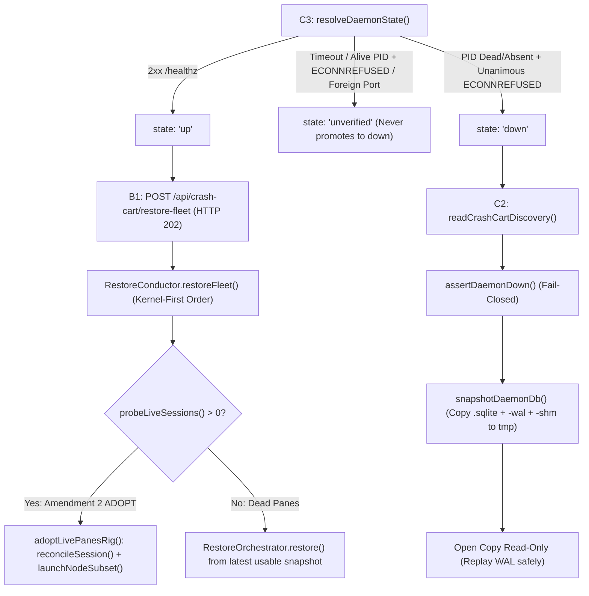

# OpenRig Daemon Audit: Seat Lifecycle, Activity Supervision, Health Detectors, Stream Classifier, Seat Recap Store, and Crash-Cart Architecture

**Task**: `[task-mvptc9d2-u3g0]` — Audit OpenRig daemon seat lifecycle, stream classifier, and crash-cart architecture  
**Author**: Worker Agent `cubicle-02` (Gemini 4 Argon (High))  
**Source Audited**: `H:\My Drive\Gemini Antigravity\scratch\openrig_panopticon\packages\daemon\src`  
**Target System**: Symlinked Agent Swarm (`Panopticon` — `src/server/consular-engine.ts`, `src/server/cubicle-manager.ts`, `src/server/cli-dispatcher.ts`, `src/server/cli-engine.ts`)

---

## Executive Summary: Why Panopticon Suffers CLI Timeouts & How OpenRig Eliminates Them

### Root Cause in Panopticon
In Panopticon (`src/server/consular-engine.ts` lines 502–721 and `src/server/cli-engine.ts` lines 48–198), worker cubicle dispatch (`dispatchTaskToCubicle`) and Consular deliberation (`invokeConsulCli`) spawn **ephemeral one-shot child processes** (`agy.exe -p ...` or `codex.exe exec --ephemeral ...`) wrapped in a blocking `Promise` with a **hard wall-clock `setTimeout`** (`420,000 ms` / 7 minutes for worker cubicles at line 1073; `600,000 ms` / 10 minutes for Consul turns at line 502):

```ts
// Panopticon anti-pattern (src/server/consular-engine.ts:577-582)
const timer = setTimeout(() => {
  timedOut = true;
  try { child.kill(); } catch {}
  finish(rawOut.trim() || `[CLI Timeout after ${Math.round(timeoutMs / 1000)}s]`);
}, timeoutMs);
```

When a worker cubicle or Consul executes multi-step repository audits, builds, or test suites that exceed the fixed wall-clock timer—even while actively streaming thoughts and tool calls—Panopticon forcefully kills the process (`child.kill()`), loses mid-turn state, or prematurely submits partial output to Gate 2 Review.

### How OpenRig Eliminates CLI Timeouts Permanently
OpenRig (`packages/daemon`) separates **process launch/delivery** from **turn completion and health supervision** across six decoupled subsystems:

1. **Non-Blocking Persistent Seat Execution (`NodeLauncher`, `StartupOrchestrator`, `SeatLifecycleService`, `RuntimeAdapter`)**: Seats are persistent stateful entities (`nodes` + `sessions` + `bindings` in SQLite) bound to terminal mux panes (`TmuxAdapter` / `HerdrAdapter`) or RPC runners (`PiRunner`). Prompt delivery (`deliverMessage`) and seat launch return as soon as the message is injected or readiness is confirmed—never blocking an HTTP handler or orchestration promise on a multi-minute turn completion timer.
2. **Ranked Activity Evidence Ladder (`SeatActivityService`)**: Instead of a blind wall-clock timer, a 1 Hz single-flight sampler arbitrates seat state (`working`, `idle`, `needs-input`, `unverified`, `stopped`) across a 4-rung evidence ladder (`lifecycle-hooks` → `self-report` → `needs-input-chrome` → `window-sampling`) with cross-rung contradiction detection and 2-tick idle debounce.
3. **Generation-Fenced Watchdog Supervision (`WatchdogScheduler` & `WatchdogPolicyEngine`)**: A 1 Hz SQLite-backed scheduler evaluates periodic reminders, idle-gate queue items, workflow keepalives, and context-usage thresholds with `occupantGeneration` fencing (`resolveTargetGeneration`), active-wake throttling (`activeWakeIntervalSeconds`), and quiet-skip suppression when a seat is actively working.
4. **Multi-Signal Health Detectors (`HealthProjectionService`)**: Evaluates 6 formal detectors (`process.ceremony-amplification`, `process.review-carousel`, `process.redundant-wake-storm`, `governance.stale-directive`, `governance.scope-admission-drift`, and `context.pressure`) to detect genuine livelocks, review loops, wake storms, and context exhaustion (`95%` warning / `99%` critical) rather than killing productive long-running seats.
5. **Lease-Fenced, Deadline-Bounded Stream Classifier (`StreamClassificationWorker`)**: Processes untagged `stream.emitted` events via a coalesced boolean wake hint, a SQLite lease with deadness evaluation (`ClassifierLeaseManager`), an attempt ledger (`ClassificationAttemptLedger`), and a `Promise.race` + `AbortController` per-attempt deadline capped by the next lease heartbeat (`min(timeoutMs, heartbeatAt - now)`).
6. **Handover Continuity (`seat-recap-store.ts`) & Crash-Cart Recovery (`crash-cart-*.ts`)**: Outgoing seat occupants write Markdown-addressable `RECAP.md` handovers with superseded chain preservation (`recap-superseded/`), while the Crash-Cart 3-state detector (`up | down | unverified`), copy-then-read WAL snapshot discovery, and async `202 Accepted` `RestoreConductor` adopt surviving panes (`adoptLivePanesRig`) or restore snapshots without losing in-progress work.

---

## 1. Seat Lifecycle & Harness Execution Architecture

### 1.1 Core Modules
- `packages/daemon/src/domain/seat-lifecycle-service.ts` (`SeatLifecycleService`)
- `packages/daemon/src/domain/node-launcher.ts` (`NodeLauncher`)
- `packages/daemon/src/domain/startup-orchestrator.ts` (`StartupOrchestrator`)
- `packages/daemon/src/domain/runtime-adapter.ts` (`RuntimeAdapter`, `RuntimeAdapterRegistry`, `resolveSeatExecutionMode`)
- `packages/daemon/src/adapters/claude-code-adapter.ts`, `codex-runtime-adapter.ts`, `pi-runtime-adapter.ts`

### 1.2 Persistent Seat Model vs. Ephemeral Process Spawning
In OpenRig, a seat (`Node`) has durable configuration (`runtime`, `model`, `effort`, `permissionMode`, `cwd`, `sandboxMode`, `LaunchSpec`, `StartupProfile`) persisted in SQLite (`nodes` table). Runtime execution is decoupled from seat identity via two additional tables:
- `sessions`: Tracks the active terminal pane or runner instance (`id`, `runtime`, `status`, `paneId`, `windowName`, `transcriptPath`, `startedAt`, `endedAt`).
- `bindings`: Links `nodeId` ↔ `sessionId`.

### 1.3 `occupantGeneration` Fencing & Atomic Launch (`NodeLauncher`)
Every time a seat is launched or restarted, `NodeLauncher.launchNode(nodeId, opts)` (`node-launcher.ts:138-347`):
1. Calls `this.nodes.reserveOccupantGeneration(nodeId)` to allocate a fresh UUID (`occupantGeneration`) before the session exists.
2. Injects `OPENRIG_OCCUPANT_GENERATION: occupantGeneration` into the harness environment alongside `OPENRIG_RIG`, `OPENRIG_SEAT`, `OPENRIG_DAEMON_URL`, and `OPENRIG_HARNESS`.
3. Launches the command inside a persistent terminal session (`mux.createSession`) or takes over a pre-created pane (`mux.takeOverPane`), and starts bounded transcript capture (`mux.startTranscriptRotation` with `maxBytes` and `maxBackups`).
4. Runs a **single atomic SQLite transaction** (`this.db.transaction`) that inserts the `sessions` row, inserts the `bindings` row, updates `node.status = 'running'`, stamps `node.occupantGeneration`, and emits the `node.launched` event. If the DB transaction fails, `NodeLauncher` kills the orphan pane (`mux.killSession`) in the `catch` block so no untracked process survives.

### 1.4 10-Stage Non-Blocking Startup State Machine (`StartupOrchestrator`)
Instead of stuffing all instructions into a single CLI `-p` flag and waiting for process exit, `StartupOrchestrator.startNode(nodeId, options)` (`startup-orchestrator.ts:471-800`) drives a resumable state machine persisted in `node.startupState`:
1. **`pending`**: Emits `node.startup_started` and resolves predecessor recap (`predecessorRecapResolver`) if `includeLastRecap` is configured.
2. **`project`**: Materializes harness-specific settings and skills (`projectSeat`, e.g., `.claude/settings.local.json` or `.codex/` config) into the seat workspace.
3. **`pre-launch files`**: Writes declarative file injections (`when === 'before_launch'`).
4. **`launchHarness`**: Calls `NodeLauncher.launchNode` (or `piRunner.startSession` for `pi-rpc` seats) and records `sessionId`.
5. **`checkReady`**: Polls `adapter.checkReady(sessionId)` at `pollIntervalMs = 250ms` up to `readinessTimeoutMs` (default `15,000 ms`, configurable per `StartupProfile`) until the interactive CLI prompt or RPC sidecar is ready for input.
6. **`post-launch files`**: Writes post-launch file injections (`when === 'after_launch'`).
7. **`after_files` / `after_ready` Startup Actions**: Executes ordered `StartupAction` steps (`inject_prompt`, `run_command`, `send_keys`), including bounded readiness re-verification and first-turn delivery confirmation (`verifyFirstTurnDelivery`, retrying up to 2 times if the TUI swallowed the initial paste during initialization).
8. **`ready`**: Stamps `phase = 'ready'` and emits `node.startup_ready`.

If startup fails mid-sequence (`failed` phase), `SeatLifecycleService.continueStartup(nodeId)` (`seat-lifecycle-service.ts:299`) can resume from the failed stage without tearing down the seat.

### 1.5 Classified Liveness Probing & `deliveryGuard` Serialization (`SeatLifecycleService`)
`SeatLifecycleService` (`seat-lifecycle-service.ts:272-360`) exposes Orthogonal Seat Lifecycle verbs:
- **Settings verbs (staged on seat; applied on next launch/restart)**: `setModel`, `setCwd`, `setEffort`, `setPermissions`, `setPolicy`.
- **Execution verbs**: `stopSeat`, `cleanSeat`, `launchFresh`, `restartInPlace`, `continueStartup`.

Two safety mechanisms prevent race conditions:
1. **`deliveryGuard.lifecycle([nodeId], fn)`**: Every lifecycle transition acquires an exclusive per-seat lock via `DeliveryGuard`, preventing message delivery (`deliverMessage`), watchdog wakes, and lifecycle restarts from colliding on the same pane.
2. **3-State Liveness Classification (`probeLiveness`, `seat-lifecycle-service.ts:421-462`)**:
   - `'present'`: Pane/session exists in the mux.
   - `'absent'`: Confirmed dead/missing (`SessionNotFoundError` or `mux.hasSession === false`).
   - `'transport_unavailable'`: Transient probe failure (timeout, socket contention).
   - **Critical Invariant**: `transport_unavailable` **never** mutates seat state to `stopped` and never deletes bindings; operations requiring verified absence fail closed with `SeatLifecycleError('transport_unavailable', ...)` (HTTP 503).

---

## 2. Ranked Activity Evidence Ladder & Supervision (`SeatActivityService` & `WatchdogScheduler`)

### 2.1 `SeatActivityService`: 4-Rung Evidence Ladder (`seat-activity-service.ts`)
Instead of guessing whether a CLI process is hung via a static timeout, `SeatActivityService` (`seat-activity-service.ts:223-800`) runs a 1 Hz (`DEFAULT_POLL_INTERVAL_MS = 1000`) single-flight sweep (`if (this.sweeping) return;`) across all running seats and arbitrates their live state (`working | idle | needs-input | unverified | stopped`) using a ranked evidence ladder (`EVIDENCE_RUNG_RANK`):

| Rank | Rung Name | Signal Source | Authority & Fallback Rules |
| :--- | :--- | :--- | :--- |
| **3 (Highest)** | `lifecycle-hooks` | Harness lifecycle hooks (`UserPromptSubmit`, `PreToolUse`, `PostToolUse`, `Stop`, `SubagentStop`) relayed to `/api/hooks/activity` | Authoritative within `HOOK_AUTHORITY_WINDOW_MS` (`30,000 ms`). Subject to cross-rung contradiction degradation after `5,000 ms`. |
| **2** | `self-report` | Harness sidecar state (e.g., Claude `pid.json` status, Pi RPC stream state) | Authoritative when fresh and no active hook overrides it. |
| **1** | `needs-input-chrome` | Terminal pane chrome inspection (`detectNeedsInputChrome`) | Detects interactive permission/confirmation prompts. Applies `PERMISSION_REQUEST_GRACE_MS = 3,000 ms` before escalating to `needs-input`. |
| **0 (Lowest)** | `window-sampling` | Tmux/Herdr `window_activity` epoch delta (`nowSec - lastActivityEpoch < silenceWindowSeconds`) + terminal prompt inspection | Uses a **2-tick idle debounce** (`SAMPLING_IDLE_DEBOUNCE_TICKS = 2`, ~2 seconds) so brief mid-turn pauses between LLM tool calls never falsely flip a `working` seat to `idle`. |

#### Cross-Rung Contradiction Detection (`CROSS_RUNG_CONTRADICTION_WINDOW_MS = 5,000 ms`)
If a harness crashes mid-tool-call or drops its `Stop` hook, `lifecycle-hooks` could stay stuck at `"working"`. `SeatActivityService` cross-checks the hook state against `window-sampling`: if `window-sampling` observes `"idle-at-prompt"` continuously for `>= 5,000 ms` while the hook still claims `"working"`, the hook's authority is degraded to `"identity-only"` and `window-sampling` wins, transitioning the seat cleanly to `idle`.

#### Event-Driven State Waiting (`waitForSeatState`)
Callers never block on child process exit. Instead, `waitForSeatState(nodeId, { afterSeq, timeoutMs })` (`seat-activity-service.ts:320-385`) subscribes to internal monotonic `seq` transitions (`SeatStateSnapshot.seq`). If the caller's `afterSeq < current.seq`, it resolves immediately; otherwise it waits for the next state change event.

### 2.2 `WatchdogScheduler` & `WatchdogPolicyEngine` (`watchdog-scheduler.ts`, `watchdog-policy-engine.ts`)
`WatchdogScheduler` (`watchdog-scheduler.ts:35-162`) runs a 1 Hz single-flight tick over enabled SQLite `watchdog_jobs`. Each tick invokes `WatchdogPolicyEngine.evaluate(job)`:
- **Supported Policy Types**:
  - `periodic-reminder`: Periodic seat check-ins (with `activeWakeIntervalSeconds` throttling when the target seat is already `working`).
  - `idle-gate-qitem`: Wakes a seat only when it transitions to `idle` and has pending queue items.
  - `workflow-keepalive`: Detects stalled multi-seat workflows when all participating seats go idle without terminal artifacts.
  - `artifact-pool-ready` & `edge-artifact-required`: Event/artifact-driven wakes.
  - `context-usage-threshold`: Fires when a seat's context window crosses a configured percentage.
- **Generation Fencing (`resolveTargetGeneration`, `watchdog-policy-engine.ts:44-89`)**: If a watchdog job is bound to `targetGeneration` (an `occupantGeneration` UUID) and the seat has since been restarted or cleaned (mismatching `node.occupantGeneration`), the job automatically transitions to `'completed'` (`generation-mismatch-auto-complete`) and never delivers stale reminders to the new occupant.
- **Quiet-Skip Suppression (`QUIET_SKIP_REASONS`)**: When a watchdog skips firing because `target-seat-working`, `target-seat-active-throttled`, `queue-empty`, or `below-threshold`, it updates `lastEvaluatedAt` silently without polluting the event log (`watchdog.skipped` is only emitted for actionable anomalies).
- **Reminder Digest Coalescing**: Multiple reminders targeting the same seat within a single tick pass are held and coalesced into a single batched delivery via `deliverHeldReminders()` at the end of the pass.

---

## 3. Health Detectors Architecture (`health-detectors.ts`)

`packages/daemon/src/domain/health-detectors.ts` implements `HealthProjectionService` (`health-detectors.ts:535-591`), which evaluates observations from registered `HealthObservationSource` instances into deduplicated, evidence-backed `HealthRecord` diagnostics across 6 detectors:

### 3.1 Process Detectors (Livelock & Churn Detection)
1. **`process.ceremony-amplification` (`evaluateCeremonyAmplification`, lines 281–312)**:
   - **Trigger**: `coordinationTransitions >= ceremonyTransitions` (default `6`) AND `coordinationTransitions / max(1, productStateChanges) >= ceremonyRatio` (default `3.0`).
   - **Severity**: `warning` at ratio `>= 3.0`, `critical` at ratio `>= 6.0` (`ceremonyRatio * 2`).
   - **Two-Stage Passive Ceremony Assessment (`evaluatePassiveCeremony`, lines 314–364)**: Allows an agentic assessor (`CeremonyAssessor`) to inspect questionable coordination events against productive artifacts; only raises a `HealthRecord` if `verdict === 'disproportionate'`.
2. **`process.review-carousel` (`evaluateReviewCarousel`, lines 366–394)**:
   - **Trigger**: `reviewReturns >= reviewReturnsThreshold` (default `3`) while `candidateChanges === 0` AND `newRiskClasses === 0`.
   - **Severity**: `warning` at `>= 3` returns, `critical` at `>= 4` returns.
   - **Relevance to Panopticon**: Directly models Gate 2 Consular Veto loops where a task bounces repeatedly between worker and Consul without candidate diff changes.
3. **`process.redundant-wake-storm` (`evaluateRedundantWakeStorm`, lines 396–426)**:
   - **Trigger**: `existingNextAction === true` AND `(wakeCount - rescueWakeCount) >= redundantWakes` (default `3`).
   - **Severity**: `warning` at `>= 3` non-rescue wakes, `critical` at `>= 5`.

### 3.2 Governance Detectors
4. **`governance.stale-directive` (`evaluateStaleDirective`, lines 428–454)**:
   - Detects when an active directive (`directiveRef`) has a `phaseConflict` or `rigorConflict` against newer addressable state (`newerStateRef`).
5. **`governance.scope-admission-drift` (`evaluateScopeAdmissionDrift`, lines 456–480)**:
   - Detects when an active mission contains a buildable slice (`sliceRef`) with `hasAdmissionAuthority === false`.

### 3.3 Live Context Pressure Detector (`context.pressure`)
6. **`context.pressure` (`LiveContextHealthSource` & `evaluateContextPressure`, lines 155–279, 482–533)**:
   - **Ingestion**: `LiveContextHealthSource.recordContextUsage()` ingests real-time token telemetry (`usedTokens`, `contextWindowTokens`, `percentUsed`) per seat.
   - **Retention & Freshness**: Retains samples for `LIVE_CONTEXT_RETENTION_SECONDS = 86,400` (24h) and treats episodes as active within `LIVE_CONTEXT_FRESHNESS_SECONDS = 600` (10m).
   - **Thresholds**: `warningPercent = 95%`, `criticalPercent = 99%` (`DEFAULT_HEALTH_DETECTOR_THRESHOLDS.contextPressure`).
   - **Evidence Compaction (`selectContextEpisodeSamples`, lines 239–266)**: Instead of dumping hundreds of raw token samples, compacts each high-pressure episode into at most 3 canonical `HealthEvidenceRef` pointers: `[firstPressure, peak, latest]`.

---

## 4. Stream Classification Worker (`stream-classification-worker.ts`)

`packages/daemon/src/domain/stream-classification-worker.ts` (`StreamClassificationWorker`, lines 88–273) classifies untagged agent stream emissions (`stream.emitted` events) asynchronously without blocking seat execution or creating runaway background loops.

### 4.1 Architectural Invariants
1. **Wake-Driven, Not Polling-Loop Driven**:
   - `StreamClassificationWorker` has no internal `setInterval`.
   - `notify()` (wired to the event bus via `subscribe()`) simply sets a coalesced boolean flag `this.hinted = true` (`lines 121-125`). Even if a seat emits 10,000 stream chunks per second, queue memory overhead is `O(1)`.
   - `wake()` (`lines 136-248`) is triggered externally by the watchdog's `periodic-reminder` cadence (`leaseTTL / 3`).
2. **Lease-Fenced Single-Owner Execution (`ClassifierLeaseManager`)**:
   - Before touching any stream item, `wake()` calls `this.leases.evaluateDeadness(now)` and `this.maintainLease(now)` (`lines 159-165, 250-264`).
   - If the worker does not hold the lease, it calls `this.leases.acquire(this.owner, now)`. If another classifier holds a live lease, it sets `this.acquireAfter = held.heartbeatAt` and returns `leaseHeld: false` immediately.
   - If theworker already holds the lease, it renews the heartbeat via `this.leases.heartbeat(this.owner, now)`.
3. **Bounded Pagination via `ClassificationAttemptLedger`**:
   - Queries `this.attempts.eligible(now, this.pageSize)` where `pageSize = min(configured, MAX_ELIGIBLE_PAGE = 50)`.
   - Requests `pageSize + 1` rows (`probeLimit`) so it can accurately report `result.moreEligible = probe.length > this.pageSize`.
4. **Per-Item Deadline Capped by Lease Heartbeat (`Promise.race` + `AbortController`)**:
   - For each eligible `eventId`, calls `this.attempts.begin(eventId, this.owner, now)`.
   - Computes the hard deadline as `budget = Math.max(1, Math.min(this.timeoutMs, lease.heartbeatAt - callStart))` (`line 191`) so a slow LLM classification call can never outlive the worker's lease window.
   - Races `this.decide(item, controller.signal)` against a timer that fires `controller.abort()`.
5. **Single-In-Flight Protection Against Ignored `AbortSignal` (`this.pending`)**:
   - Sets `this.pending = true` before invoking `this.decide()` and only clears `this.pending = false` inside `raw.then(..., ...)` when the underlying promise actually settles (`lines 194-200`).
   - If a call times out and the underlying provider ignores `AbortSignal`, `this.attempts.fail(eventId, 'timeout', ...)` is recorded immediately, and the loop checks `if (this.pending) { result.moreEligible = true; break; }` (`lines 238-241`), refusing to launch another concurrent `decide()` call until the zombie promise settles.

---

## 5. Seat Recap Store & Handover Continuity (`seat-recap-store.ts` & `predecessor-recap-resolver.ts`)

### 5.1 Durable Seat Handovers (`seat-recap-store.ts`)
When a seat occupant finishes a mission, rotates due to context pressure, or is replaced via `cleanSeat` / `launchFresh`, `writeSeatRecap` (`packages/daemon/src/domain/context-packs/seat-recap-store.ts:138-243`) persists a structured handover at:
- **Canonical path**: `<workspaceRoot>/rigs/<rig>/seats/<seat>/RECAP.md`
- **Superseded chain**: `<workspaceRoot>/rigs/<rig>/seats/<seat>/recap-superseded/RECAP-<15-digit-epoch-ms>[-N].md`

#### Key Safety & Validation Guarantees
1. **Two Validation Altitudes**:
   - **Hard Gate on Write (`validateMarkdownAddressability`)**: Rejects writes (`RecapMarkdownError`) if `RECAP.md` contains duplicate heading paths or unclosed code fences, guaranteeing that context-pack selectors (`seat:RECAP.md#section`) always resolve deterministically.
   - **Advisory Authoring Contract (`validateRecapContract`, lines 77–115)**: Inspects parsed sections for a `decision`-titled heading and checks whether unverified cues (`todo`, `tbd`, `untested`, `not yet verified`) use the canonical uppercase `UNVERIFIED:` marker so successor seats can grep unverified claims mechanically. Returns advisory warnings without blocking crash/shutdown writes.
2. **Symlink-Escape Rejection (`assertNoSymlinkInSeatPath`, lines 155–183)**:
   - Walks every path segment from `<workspaceRoot>` through `rigs/<rig>/seats/<seat>`, `RECAP.md`, and `recap-superseded/` using `lstatSync`, throwing `RecapFilesystemError` if any segment is a symbolic link.
3. **Zero-Loss Atomic Rotation (`lines 195-235`)**:
   - Stages incoming content to `.RECAP-<uuid>.tmp`.
   - If `RECAP.md` already exists, links (`linkSync`, with `copyFileSync` fallback on `EXDEV`/`EPERM`) the existing `RECAP.md` into `recap-superseded/RECAP-<timestamp>.md` before atomically renaming (`renameSync`) `.RECAP-<uuid>.tmp` over `RECAP.md`.

### 5.2 Automated Predecessor Transcript Extraction (`predecessor-recap-resolver.ts`)
When a seat restarts or rotates without having written an explicit `RECAP.md`, `makePredecessorRecapResolver` (`packages/daemon/src/domain/predecessor-recap-resolver.ts:27-89`) extracts the last `maxExchanges = 6` user/assistant exchanges (`maxCharsPerExchange = 500`) from the predecessor's JSONL transcript (`Claude` `transcript_path` or `Codex` `rollout_path`).
- **Session-Reuse Race Guard (`lines 42-50`)**: Because terminal session names (`openrig-<rig>-<seat>`) are reused across occupant generations, the resolver verifies that `sidecar.sessionId === node.resumeToken` before reading `sidecar.transcriptPath`, falling back to `discoverTranscriptByToken(node.resumeToken)` if the new occupant has already overwritten the sidecar file.

---

## 6. Crash-Cart Architecture (`crash-cart-*.ts` & `routes/crash-cart.ts`)

OpenRig's Crash-Cart subsystem enables full fleet inspection and recovery when the daemon crashes, hangs, or restarts. It is organized around three formal architectural contracts (**C3**, **C2**, and **B1**):



### 6.1 Contract C3: 3-State Daemon Detector (`crash-cart-detect.ts`, `crash-cart-probes.ts`, `crash-cart-emit.ts`)
- **States**: `"up" | "down" | "unverified"`.
- **Positive `"down"` Predicate (`classifyOnce`, `crash-cart-detect.ts:17-66`)**:
  - `"down"` is a **positive predicate**, never a fallback. It is returned ONLY when:
    1. `daemon.json` is missing (`ENOENT`), OR
    2. `isProcessAlive(daemonJson.pid) === false` (`process.kill(pid, 0)` throws `ESRCH`) **AND** `/healthz` fails with **unanimous `ECONNREFUSED`** across every leaf error in `AggregateError` / `.cause` chains (`isConnectionRefused` via cycle-safe `collectTerminalAttempts`, `crash-cart-probes.ts:34-91`).
- **Critical Invariant — Timeouts Never Promote to `"down"`**:
  - If `/healthz` times out (`AbortError` / `ETIMEDOUT`), or if the PID is alive while the socket refuses connections, or if another process occupies the port, `classifyOnce` returns `"unverified"`.
  - `resolveDaemonState` (`crash-cart-detect.ts:74-94`) retries `"unverified"` up to 3 times (`retryDelayMs = 400 ms`), and if still unverified, emits `"unverified"`—preventing split-brain recovery against a slow or GC-paused daemon.

### 6.2 Contract C2: Fail-Closed Copy-Then-Read WAL Discovery (`crash-cart-discovery.ts`)
When the daemon is down, operators or recovery tools need to know what seats and queue items were running (`readCrashCartDiscovery`, `crash-cart-discovery.ts:327-374`):
1. **Fail-Closed Liveness Gate (`assertDaemonDown`, lines 124–166)**: Probes `daemon.json` PID and `/healthz`. If either is alive, throws `DaemonLiveError` and refuses to touch the database files.
2. **Copy-Then-Read WAL Snapshot (`snapshotDaemonDb`, lines 173–204)**:
   - Opening a crashed SQLite database that has an uncommitted `-wal` file directly in read-only mode either fails to replay the WAL or mutates the original files on disk.
   - `snapshotDaemonDb` copies `openrig.sqlite`, `openrig.sqlite-wal`, and `openrig.sqlite-shm` into a disposable temp directory (`mkdtempSync('openrig-crash-cart-')`) and opens the **copy** via `new Database(copiedDbPath, { readonly: true })`, allowing SQLite to safely replay uncommitted WAL frames in the scratch copy before deleting the scratch directory in `finally`.
3. **Discovery Payload**: Extracts `header` (`crashedAt` from `max(walMtime, dbMtime)`), `foundOnHost` (`seatCount`, `runningCount`, `resumableCount` per rig), and `whereWorkStopped` (all `queue_items` where `state = 'in-progress'`).

### 6.3 Contract B1: Async Fleet Restore Conductor & Amendment 2 Live-Pane Adoption (`crash-cart-conductor.ts`, `routes/crash-cart.ts`)
When the daemon restarts after a crash, `POST /api/crash-cart/restore-fleet` (`routes/crash-cart.ts:72-97`) triggers `RestoreConductor.restoreFleet()`:
1. **On-Commit `HTTP 202 Accepted`**: Generates a `fleetAttemptId`, registers the attempt in memory, launches the async loop via `void this.runFleetAttempt(...)`, and immediately returns `202 { fleetAttemptId, status: "started" }`.
2. **Kernel-First Ordering & Cooperative Cancellation**:
   - Restores rigs in `listRigsInKernelFirstOrder()` (`kernel` rig first, then remaining rigs alphabetically).
   - Polls `isCancelled()` before starting each rig (`stop-before-next-rig` semantics via `POST /api/crash-cart/restore-fleet/:id/cancel`), marking remaining rigs as `not_attempted` with `reason = "cancelled_by_operator"` without killing an in-flight rig mid-restore.
3. **Amendment 2 Live-Pane Adoption (`adoptLivePanesRig` vs. Snapshot Restore, `routes/crash-cart.ts:103-180`)**:
   - Before tearing down or restoring a rig from a snapshot, `createDefaultRestoreRig` calls `lifecycle.probeLiveSessions(rigId)`.
   - **Surviving Panes Path (`ADOPT`)**: If terminal panes survived the daemon crash (`liveSessionIds.length > 0`), it runs `adoptLivePanesRig`: calls `lifecycle.reconcileSession(nodeId)` for every surviving session (re-binding the live process without interrupting its turn) and calls `lifecycle.launchNodeSubset(rigId, launchSet)` only for the seats whose panes died.
   - **Dead Panes Path (`RESTORE`)**: If no panes survived, selects the latest usable snapshot (`manifest.restoreUsable !== false`) and invokes `RestoreOrchestrator.restore()`.
4. **Derived Fleet Verdict (`deriveFleetVerdict`, `crash-cart-conductor.ts:127-166`)**:
   - Computes `FleetVerdict` (`in_progress | succeeded | attention_required | failed | cancelled`) on demand from the closed 4-member `PerRigOutcome` union (`fully_restored | partially_restored | failed | not_attempted`) and deduplicated `attention_required` per-seat triage rows.

---

## 7. Concrete Porting Blueprint for Panopticon (Eliminating CLI Timeouts Permanently)

To permanently eliminate CLI timeouts in Panopticon (`src/server/consular-engine.ts`, `src/server/cubicle-manager.ts`, `src/server/cli-engine.ts`, `src/server/cli-dispatcher.ts`), port OpenRig's execution and supervision patterns in four phases:

### Phase 1: Replace Fixed Wall-Clock CLI Timers with `SeatActivityService` Evidence Ladder
- **Current bottleneck**: `ConsularEngine.invokeConsulCli` (`src/server/consular-engine.ts:577`) and `CLIEngine.spawnInteractive` (`src/server/cli-engine.ts:169`) kill worker and Consul processes after a fixed `timeoutMs` (`420s` / `600s`), regardless of whether the agent is actively streaming output or executing tools.
- **Porting Action**:
  1. Port `SeatActivityService` (`packages/daemon/src/domain/seat-activity-service.ts`) into `src/server/seat-activity-service.ts`.
  2. Wire the 4-rung evidence ladder for each `cubicle-XX` and Consul process:
     - **Rung 3 (`lifecycle-hooks`)**: Emit hook heartbeats when a worker calls `/api/cubicles` or `/api/messages` or writes to `.swarm/status/<cubicleId>.json`.
     - **Rung 2 (`self-report`)**: Track stdout/stderr chunk arrival timestamps and JSONL thought stream writes in `ConsularEngine.invokeConsulCli`.
     - **Rung 0 (`window-sampling`)**: Inspect worktree file mtimes and process tree CPU/IO activity at 1 Hz with the 2-tick idle debounce (`SAMPLING_IDLE_DEBOUNCE_TICKS = 2`).
  3. Replace the fixed wall-clock `setTimeout` in `invokeConsulCli` and `dispatchTaskToCubicle` with **inactivity-based supervision**: as long as the evidence ladder reports `state === 'working'` (active stdout chunks, tool invocations, or worktree file mutations within the silence window), the turn is never killed for wall-clock duration.

### Phase 2: Port Generation-Fenced Watchdog & Health Detectors into `ConsularEngine`
- **Porting Action**:
  1. Stamp an `occupantGeneration` UUID on each cubicle dispatch in `CubicleManager` (`src/server/cubicle-manager.ts`). Fence all completion callbacks, Gate 2 triggers, and status file updates against `occupantGeneration` so a late exit from a cancelled/restarted process can never corrupt the new occupant's state.
  2. Port `HealthProjectionService` (`packages/daemon/src/domain/health-detectors.ts`) into `src/server/health-detectors.ts`:
     - Use **`process.review-carousel`** (`reviewReturns >= 3` with `candidateChanges === 0`) inside `ConsularEngine` Gate 2 Deliberation to automatically detect when a task bounces between worker and Consul veto without git diff changes, escalating to an Overseer clarification card instead of looping indefinitely.
     - Use **`process.ceremony-amplification`** (`coordinationTransitions / productStateChanges >= 3.0`) to throttle excessive inter-Consul deliberation turns when no Kanban state or code changes are occurring.
     - Use **`context.pressure`** (`LiveContextHealthSource`, `95%` warning / `99%` critical) coupled with `CubicleManager` stamina/fatigue percentage so cubicles trigger a clean handover before hitting context window limits.

### Phase 3: Port `seat-recap-store.ts` for Seamless Cubicle Handovers
- **Porting Action**:
  1. Port `writeSeatRecapAt` and `readSeatRecapAt` (`packages/daemon/src/domain/context-packs/seat-recap-store.ts`) so each isolated worktree (`worktrees/cubicle-XX/RECAP.md` + `recap-superseded/`) maintains a Markdown-addressable handover document with `lstatSync` symlink-escape protection and atomic `.tmp` staging.
  2. Port `makePredecessorRecapResolver` (`predecessor-recap-resolver.ts`) so that if a worker cubicle is interrupted or rotated at 100% fatigue, the successor worker automatically receives the bounded last 6 exchanges + `RECAP.md` (`UNVERIFIED:` claims highlighted) in its Gate 1 dispatch context.

### Phase 4: Port Crash-Cart C3/C2/B1 for Non-Destructive Swarm Restart & Live Adoption
- **Porting Action**:
  1. Persist active cubicle PIDs, `occupantGeneration`, and session metadata into SQLite/status ledger on launch (`NodeLauncher` pattern).
  2. On Panopticon server startup (`src/server/index.ts`), run the **Amendment 2 Live Adoption branch** (`adoptLivePanesRig` from `routes/crash-cart.ts:103-147`): probe whether any previously dispatched `cubicle-XX` processes are still alive (`isProcessAlive(pid)`). Re-attach (`reconcileSession`) to surviving worker processes instead of resetting all cubicles to `idle` and stranding in-flight tasks.
  3. Expose `GET /api/crash-cart/discovery` (C2 copy-then-read snapshot) and `POST /api/crash-cart/restore-fleet` (`HTTP 202 Accepted` `RestoreConductor`) so the Overseer UI can inspect and recover interrupted swarm tasks after a host reboot or daemon crash.
